# Oracle CLOB 반복 조회가 I/O 병목을 만드는 이유와 계층별 개선 방법

Oracle Database에 저장된 대용량 텍스트를 여러 API에서 반복 조회하는 구조를 분석할 일이 있었다. 콘텐츠의 내용은 자주 바뀌지 않았지만, 조회 요청이 발생할 때마다 애플리케이션은 DB를 거쳐 CLOB 데이터를 가져오고 있었다.

일반 문자열 컬럼과 달리 CLOB은 데이터 크기와 저장 옵션에 따라 별도의 LOB Segment에 저장될 수 있다. LOB 캐싱이 비활성화되어 있다면 같은 콘텐츠를 반복 조회해도 Oracle Buffer Cache에서 해당 LOB 블록을 재사용하지 못한다. SQL의 조건이나 Join이 복잡하지 않더라도, 대용량 데이터를 반복해서 읽고 전달하는 과정이 I/O 부하를 키울 수 있는 것이다.

여기에서 한 가지 의문이 생겼다.

> 변경되지 않은 콘텐츠를 여러 번 요청하는데, 왜 매번 Oracle에서 CLOB을 읽어야 할까?

처음에는 LOB를 Buffer Cache에 올리는 방법을 생각할 수 있다. 그러나 SQL에서 불필요한 CLOB을 제외하거나, JDBC의 LOB Prefetch 크기를 조정하고, Application Cache로 DB 조회를 줄이는 방법도 있다. 인스턴스나 스토리지의 I/O 처리 용량을 늘리는 선택지도 있다.

이 방법들은 해결하는 비용이 서로 다르다. **Oracle의 물리적 읽기 횟수를 줄이는 것과, 정적 콘텐츠를 제공하기 위해 Oracle을 호출하는 구조 자체를 바꾸는 것은 구분해야 한다.**

---

## CLOB은 어떤 경우에 별도 LOB Segment에 저장될까

`VARCHAR2` 값은 일반적으로 테이블의 Row 내부에 저장된다. 반면 `CLOB(Character Large Object)`은 데이터 크기와 LOB Storage 옵션에 따라 Row 내부(In-row)에 저장되거나, 테이블과 별도인 LOB Segment(Out-of-line)에 저장된다.

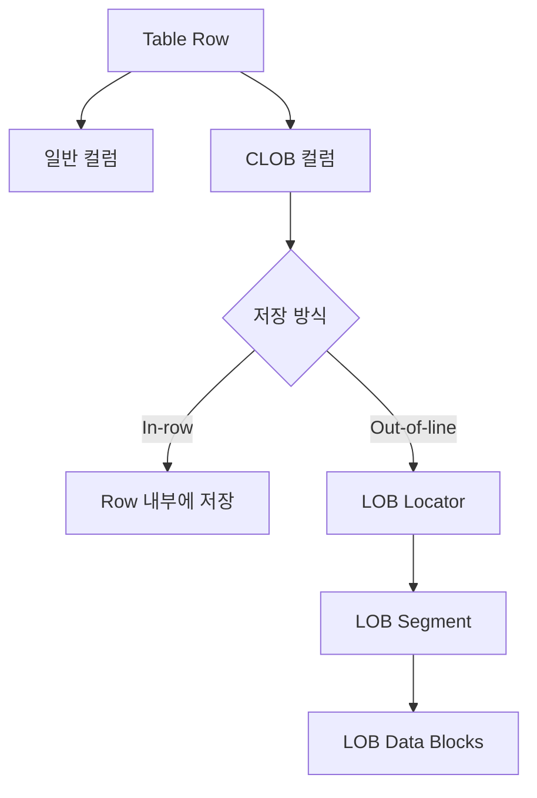

Out-of-line CLOB을 가져오려면 테이블 Row를 찾은 뒤 별도 LOB Segment에 저장된 본문까지 읽어야 한다. 조회할 데이터가 크거나 동일한 조회가 자주 실행되면 이 추가 읽기 작업이 전체 I/O 사용량에 영향을 준다.

하지만 **CLOB 컬럼이 있다는 사실만으로 매 조회마다 Physical I/O가 발생한다고 볼 수는 없다.** 실제 읽기 비용은 본문 크기, In-row/Out-of-line 저장 여부, LOB Cache 정책, 반복 조회 패턴에 따라 달라진다. 또한 `ENABLE STORAGE IN ROW`는 작은 LOB의 Row 내부 저장을 허용하는 설정이지, 모든 CLOB이 Row 내부에 존재한다는 뜻은 아니다.

반복 조회가 많은 경우 먼저 확인할 것은 해당 LOB 컬럼의 캐싱 정책이다.

| 설정 | 의미 | 적합한 접근 패턴 |
| --- | --- | --- |
| `NOCACHE` | LOB 데이터를 일반 Database Buffer Cache에 보관하지 않음 | 읽기 재사용이 적은 대용량 데이터 |
| `CACHE READS` | LOB 읽기 시 Buffer Cache 사용 | 반복적인 읽기가 많은 데이터 |
| `CACHE` | LOB 읽기와 쓰기에 Buffer Cache 사용 | 읽기·쓰기가 모두 빈번한 경우 |

Oracle 19c에서 별도 설정을 하지 않은 일반적인 LOB의 기본 캐싱 정책은 `NOCACHE`다. 이 정책에서는 Out-of-line LOB의 데이터 블록을 Oracle Database Buffer Cache에 보관하여 다음 읽기에 재사용하지 않는다.

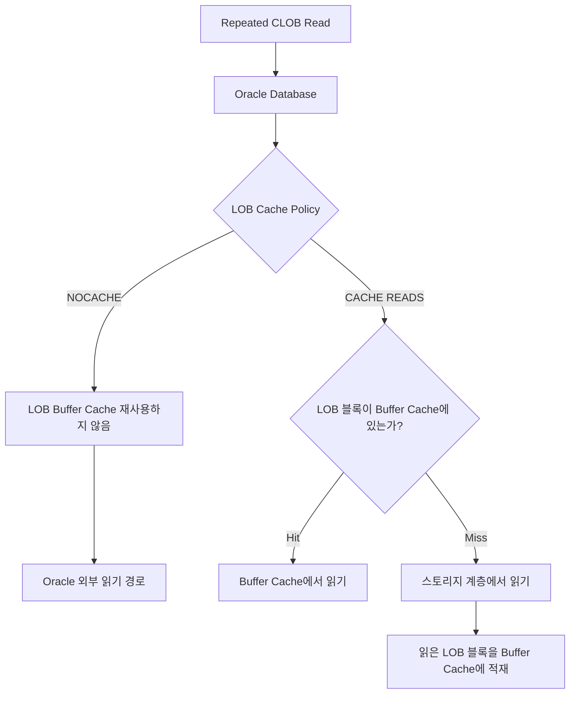

여기서 `NOCACHE`를 "조회할 때마다 실제 물리 디스크를 읽는다"로 해석하면 안 된다. 운영체제 또는 스토리지 계층의 캐시에서 요청을 처리할 수 있기 때문이다. `NOCACHE`가 보장하는 것은 **Oracle Database Buffer Cache에 해당 LOB 데이터를 보관해 재사용하지 않는다는 정책**이다.

결국 동일한 대용량 본문을 자주 조회하면서 Oracle Buffer Cache를 활용하지 못한다면, SQL 실행 계획이 단순해도 반복적인 읽기 요청이 누적될 수 있다.

---

## 스토리지 IOPS와 인스턴스 IOPS를 함께 확인해야 하는 이유

스토리지 성능을 확인할 때 흔히 IOPS(Input/Output Operations Per Second)를 먼저 살펴본다. 그러나 초당 I/O 요청 수만으로 병목 원인을 판단하기는 어렵다. 요청당 전송하는 데이터의 크기와 한 번의 I/O가 완료되기까지 걸리는 시간도 중요하다.

| Metric | 의미 |
| --- | --- |
| IOPS | 초당 처리하는 I/O 요청 수 |
| Throughput | 초당 전송하는 데이터 양 |
| Latency | 각 I/O 요청에 걸리는 시간 |
| Queue Depth | 처리 중이거나 대기 중인 I/O 요청 수 |

대략적으로 `Throughput ≈ IOPS × 평균 I/O 크기` 관계가 성립한다.

가상의 AWS EBS 기반 DB 환경에서 스토리지에 12,000 IOPS를 설정했지만, 인스턴스의 EBS I/O 처리 한도가 9,000 IOPS라고 가정하자. 실제 요청이 초당 8,600건의 I/O까지 늘었다면 스토리지의 프로비저닝 수치에는 여유가 있어 보여도 인스턴스 쪽 한계에 먼저 가까워질 수 있다.

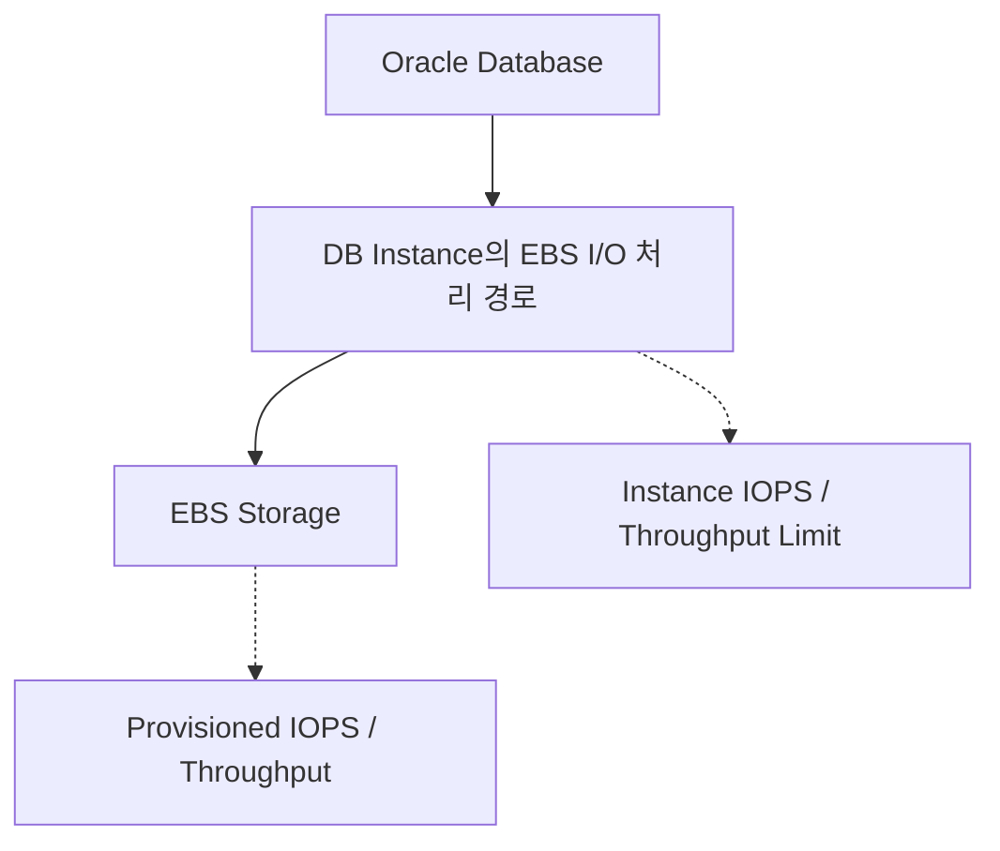

단순히 두 IOPS 수치의 최솟값만 보면 충분한 것도 아니다. EBS 대역폭(Throughput), I/O 요청 크기, 인스턴스의 Baseline/Burst 정책, 스토리지 종류에 따라 실제 처리량이 달라진다. 특정 인스턴스 클래스를 사용한다면 해당 클래스의 EBS 성능 기준도 별도로 확인해야 한다.

동일한 CLOB을 반복 조회하는 것이 I/O 증가의 주된 원인이라면, 인스턴스 증설은 초당 처리할 수 있는 요청 수를 늘려줄 수는 있어도 **같은 콘텐츠를 요청마다 Oracle에서 읽는 구조 자체를 바꾸지는 못한다.**

---

## Database Layer: CACHE READS로 반복적인 LOB 물리 읽기 줄이기

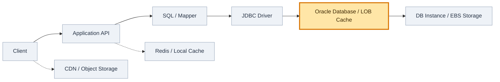


애플리케이션의 조회 로직을 그대로 유지하면서 검토할 수 있는 방법은 LOB 컬럼의 캐싱 정책을 `CACHE READS`로 변경하는 것이다.

```sql
SELECT
    OWNER, TABLE_NAME, COLUMN_NAME,
    SEGMENT_NAME, SECUREFILE, CACHE, IN_ROW
FROM DBA_LOBS
WHERE TABLE_NAME = 'CONTENT_INFO';
```

대상 테이블과 CLOB 컬럼, 현재 `CACHE` 값을 확인한 뒤 다음 DDL로 읽기 캐시 정책을 변경할 수 있다.

```sql
ALTER TABLE CONTENT_INFO
MODIFY LOB (CONTENT_BODY) (CACHE READS);
```

첫 번째 조회에서 읽은 LOB 블록이 Buffer Cache에 유지된다면 동일한 블록을 읽는 후속 요청은 스토리지 읽기 대신 메모리에서 처리될 수 있다. 특히 업데이트보다 반복 조회가 많은 콘텐츠에 적합한 후보가 된다.

다만 `CACHE READS`로 해결되지 않는 비용과 새로 발생할 수 있는 문제가 있다.

- **SQL과 DB 호출은 그대로 남는다.** Physical I/O를 줄이더라도 Oracle이 요청을 처리하고 JDBC를 통해 결과를 반환해야 한다.
- **Buffer Cache는 공유 자원이다.** LOB 블록이 많아지면 기존의 Table/Index 블록이 밀려나 다른 SQL의 Cache Hit가 감소할 수 있다. (이를 Cache Pollution이라고 한다.)

또한 DB 인스턴스의 총 메모리가 그대로 Buffer Cache 크기를 의미하지는 않는다. Oracle은 SGA의 여러 영역과 PGA 등에 메모리를 사용하므로 실제 Buffer Cache 할당량과 조정 방식을 확인해야 한다.

또한 DDL을 실행했다고 LOB 전체가 즉시 메모리에 적재되는 것은 아니다. 반복 조회 이후 Cache Hit가 얼마나 발생하는지가 중요하다. DDL의 잠금 및 운영 영향도 사전에 확인해야 한다.

따라서 `CACHE READS`는 **애플리케이션을 수정하지 않고 반복적인 LOB Physical Read를 줄일 수 있는 단기 최적화 후보**다. 그러나 Oracle이 정적 본문의 조회와 전송을 계속 담당한다는 점은 달라지지 않는다.

---

## SQL Layer: 목록 조회와 상세 조회를 분리해 불필요한 CLOB 읽기 제거하기

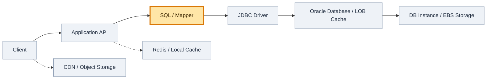


다음으로는 SQL에서 실제 사용하지 않는 LOB를 가져오고 있지 않은지 확인할 필요가 있다.

예를 들어 목록 화면에는 제목과 요약만 필요한데 상세 본문까지 조회하고 있다고 해보자.

```sql
-- 목록에서도 상세 CLOB을 읽는 구조
SELECT CONTENT_ID, TITLE, SUMMARY, CONTENT_BODY
FROM CONTENT_INFO
WHERE CONTENT_TYPE = :contentType;
```

이를 목록 조회와 상세 조회로 나눌 수 있다.

```sql
-- 목록
SELECT CONTENT_ID, TITLE, SUMMARY
FROM CONTENT_INFO
WHERE CONTENT_TYPE = :contentType;

-- 상세 화면 진입 시
SELECT CONTENT_BODY
FROM CONTENT_INFO
WHERE CONTENT_ID = :contentId;
```

이렇게 분리하면 목록을 표시할 때 필요 없는 LOB 데이터를 읽고 전송하지 않아도 된다. DB의 LOB 접근뿐 아니라 JDBC 전송량과 Java 객체에 본문을 담는 비용도 줄일 수 있다.

반면 하나의 요청에서 상세 본문이 반드시 필요한 API라면 분리 효과가 없다. 기존 목록 응답에 본문을 포함하고 있었다면 API 응답 계약과 MyBatis Mapper도 변경해야 한다. 목록에 표시된 여러 항목의 상세정보를 곧바로 다시 요청하는 화면에서는 추가 API 호출이 늘어날 수 있으므로 실제 화면 동작을 함께 고려해야 한다.

**캐싱으로 더 빠르게 읽기 전에, 애초에 읽어야 하는 데이터인지 확인하는 것이 먼저다.**

---

## JDBC Layer: LOB Prefetch로 추가 데이터 Fetch 요청 줄이기

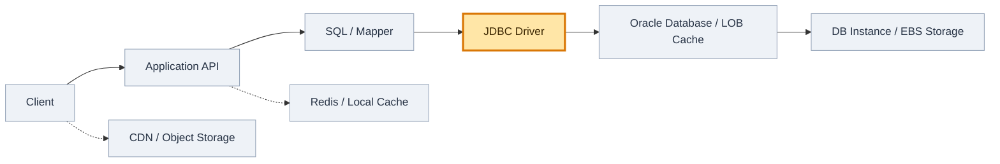


Oracle JDBC는 CLOB의 내용을 가져올 때 LOB Locator를 사용한다. LOB Prefetch는 SQL의 Row Fetch 과정에서 LOB Locator뿐 아니라 설정한 크기만큼의 본문도 미리 전달하는 기능이다. 본문이 Prefetch 범위를 초과하거나 추가 읽기가 필요한 경우에는 후속 LOB Read가 발생할 수 있다.

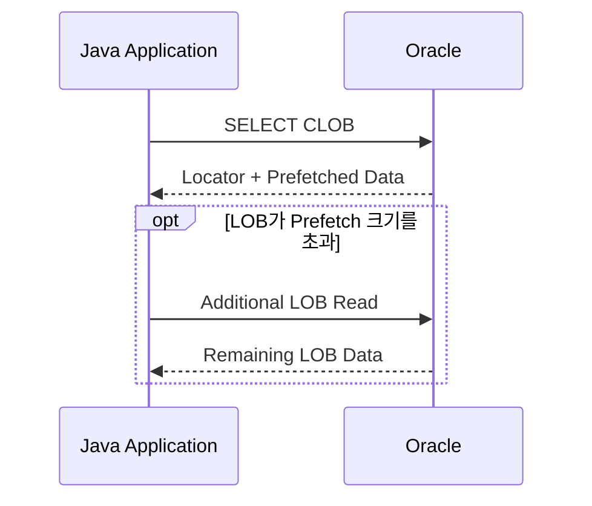

Oracle JDBC 연결 속성의 설정 예시는 다음과 같다.

```properties
oracle.jdbc.defaultLobPrefetchSize=32768
```

`defaultLobPrefetchSize`는 CLOB의 경우 문자 수, BLOB의 경우 Byte 수를 기준으로 한다. 예시의 `32768`은 모든 CLOB을 32KiB만큼 가져온다는 의미가 아니라, CLOB에서 최대 32,768문자를 Prefetch하도록 설정한다는 의미다. (기본값은 사용하는 ojdbc 버전과 설정에 따라 확인해야 하며, MyBatis Type Handler가 LOB를 읽는 방식도 실제 효과에 영향을 준다.)

CLOB 본문이 Prefetch 범위 안에 들어오면 추가 LOB Read를 줄일 수 있다. 다만 다수의 Row에서 큰 CLOB을 함께 조회할 때 Prefetch 크기를 무조건 높이면 네트워크 전송량과 JDBC가 사용하는 메모리가 오히려 늘 수 있다.

무엇보다 **Prefetch는 Oracle이 LOB를 읽는 데 필요한 Storage I/O 자체를 제거하지 않는다.** Storage IOPS가 병목이라면 LOB Cache나 조회 횟수 감소와는 구분해서 접근해야 한다.

---

## Application Layer: Redis 또는 Local Cache로 반복적인 DB 조회 제거하기

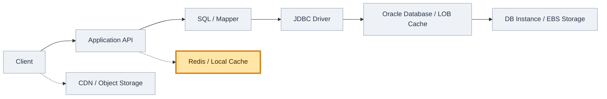


같은 콘텐츠를 여러 사용자가 반복해서 요청하고, 내용의 변경 빈도가 낮다면 애플리케이션이 조회 결과를 캐싱하는 방법도 고려할 수 있다.

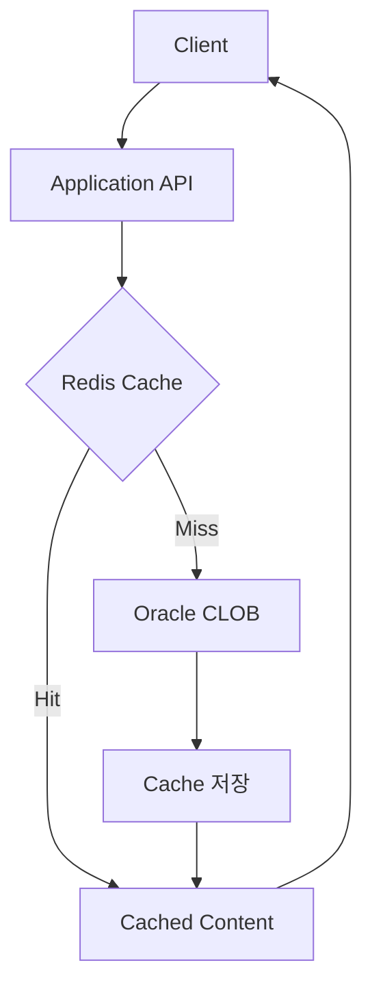

Cache Hit가 발생하면 애플리케이션은 Oracle에 SELECT를 보내지 않고 저장된 콘텐츠를 그대로 반환한다. 즉 `CACHE READS`가 **DB에 들어온 요청을 처리하면서 Physical Read를 줄이는 방식**이라면, Application Cache는 **DB에 들어오는 조회 요청 수 자체를 줄이는 방식**이다.

Local Cache(Caffeine 등)는 네트워크 호출이 없어 빠르지만 Pod별 캐시 불일치 및 JVM Heap 사용을 고려해야 한다. Redis는 여러 Pod가 데이터를 공유할 수 있지만 네트워크 요청과 Redis 운영 비용이 생긴다.

캐시는 데이터 변경 시점도 고려해야 한다. TTL만 설정하면 갱신 지연이 발생할 수 있고, 다수의 캐시가 동시에 만료되면 Cache Stampede가 발생할 수 있다. 따라서 Cache Key, Version, Invalidation, TTL Jitter 등의 정책이 필요하다.

Application Cache가 효과적으로 작동하면 Oracle의 SQL 실행과 LOB 읽기가 함께 줄어든다. 다만 Cache Miss나 콘텐츠 변경 후에는 다시 Oracle을 조회해야 하며, 대용량 정적 본문의 원본과 제공 책임이 DB에 남아 있다는 점은 달라지지 않는다.

---

## Infrastructure Layer: 스토리지와 DB 인스턴스의 I/O 처리 한도 늘리기

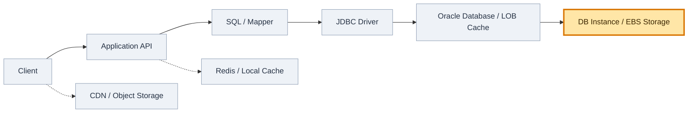


실제 지표에서 스토리지 또는 DB 인스턴스의 I/O 처리 한도에 도달한 것이 확인된다면, 성능 설정이나 인스턴스 클래스를 변경해 처리 용량을 늘리는 방안도 검토해야 한다.

다만 어떤 자원이 포화 상태인지에 따라 대응이 달라진다.

| 병목 후보 | 확인할 지표 | 대응 방향 |
| --- | --- | --- |
| Storage IOPS | Volume IOPS 사용량, Queue/Latency | Storage 성능 변경 검토 |
| Instance EBS Limit | Instance EBS IOPS/Throughput 사용량 | Instance Class 변경 검토 |
| Throughput | Read/Write MiB/s | 대역폭과 I/O 크기 검토 |
| Oracle CPU/Wait | DB Wait Event, DB CPU | SQL 및 자원 경합 별도 분석 |

인프라 증설은 코드를 바꾸지 않고 처리 여력을 확보할 수 있다는 장점이 있다. 반면 비용과 라이선스, 변경 작업의 영향도가 발생한다.

또한 Storage IOPS를 올려도 Instance EBS 한도가 먼저 걸린다면 기대한 만큼 성능이 개선되지 않을 수 있다.

**용량 증설은 필요한 작업을 더 많이 처리하게 할 뿐, 불필요한 작업을 제거하지 않는다.**

---

## 계층별 최적화는 어떤 비용을 줄이고 무엇을 해결하지 못할까

| 계층 | 선택지 | 줄어드는 비용 | 장점 | 한계 |
| --- | --- | --- | --- | --- |
| Database | `CACHE READS` | LOB Physical I/O | DDL 중심의 비교적 작은 변경 | DB 호출 유지, Cache Pollution |
| SQL | 상세 CLOB 조회 분리 | 불필요한 LOB 읽기·전송 | 필요한 데이터만 조회 | SQL/API 변경 필요 |
| JDBC | LOB Prefetch | 추가 LOB Fetch Round Trip | 통신 효율 개선 | Storage I/O 자체는 유지 |
| Application | Redis / Local Cache | 반복 DB 조회 | Oracle 부하 감소 효과 큼 | 일관성·운영 비용 |
| Infrastructure | Instance / Storage 증설 | 처리 용량 부족 | 빠른 Capacity 확보 가능 | 비용 증가, 구조 유지 |
| Architecture | Object Storage + CDN | 정적 콘텐츠의 DB 조회·API 전달 경로 | 반복 DB I/O를 구조적으로 분리 | 데이터 배포 구조 변경 필요 |

이 방법들은 모두 성능 개선을 목표로 하지만, 줄이는 비용이 서로 다르다.

`CACHE READS`는 Storage I/O를, JDBC Prefetch는 추가 통신을, Application Cache는 DB 호출을 줄인다. 서로 조합할 수도 있다.

만약 대용량 본문이 사용자별로 달라지지 않는 정적 콘텐츠라면, 조회 성능을 개선하는 것만으로는 Oracle이 콘텐츠를 제공해야 한다는 구조가 남는다. 이 경우 **본문 저장 위치와 전송 경로를 Object Storage 및 CDN으로 분리하는 방안**을 별도로 검토할 수 있다.

---

## Architecture Layer: 정적 콘텐츠를 Oracle 대신 Object Storage와 CDN에서 제공하기

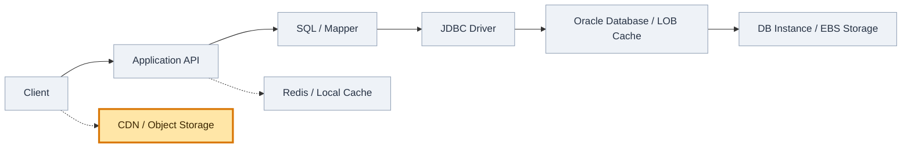


CLOB에 저장된 데이터가 모든 사용자에게 동일하고 변경 빈도가 낮은 HTML이나 설명 문서라면, Oracle은 이 데이터를 저장하고 전달하기 위한 최적의 위치인지 생각해볼 필요가 있다.

관계형 DB는 트랜잭션, 관계, 조건 검색, 정합성이 중요한 데이터를 처리하는 데 강점이 있다. 반면 동일한 대용량 정적 본문을 다수의 사용자에게 반복 배포하는 일은 Object Storage와 CDN에 더 자연스러운 책임이다.

기존 구조는 다음과 같다.

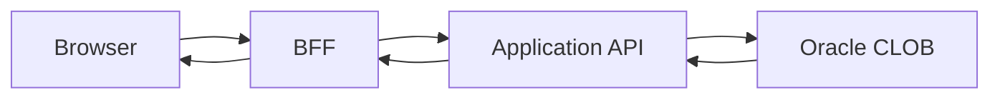

이때 캐시가 없다면 콘텐츠 조회 요청마다 Database의 LOB Read가 발생할 수 있다. `CACHE READS`를 적용하더라도 DB 요청과 JDBC 전송은 남는다.

반면 정적 콘텐츠를 Object Storage에 저장하고 CDN에서 제공하면 요청 경로를 분리할 수 있다.

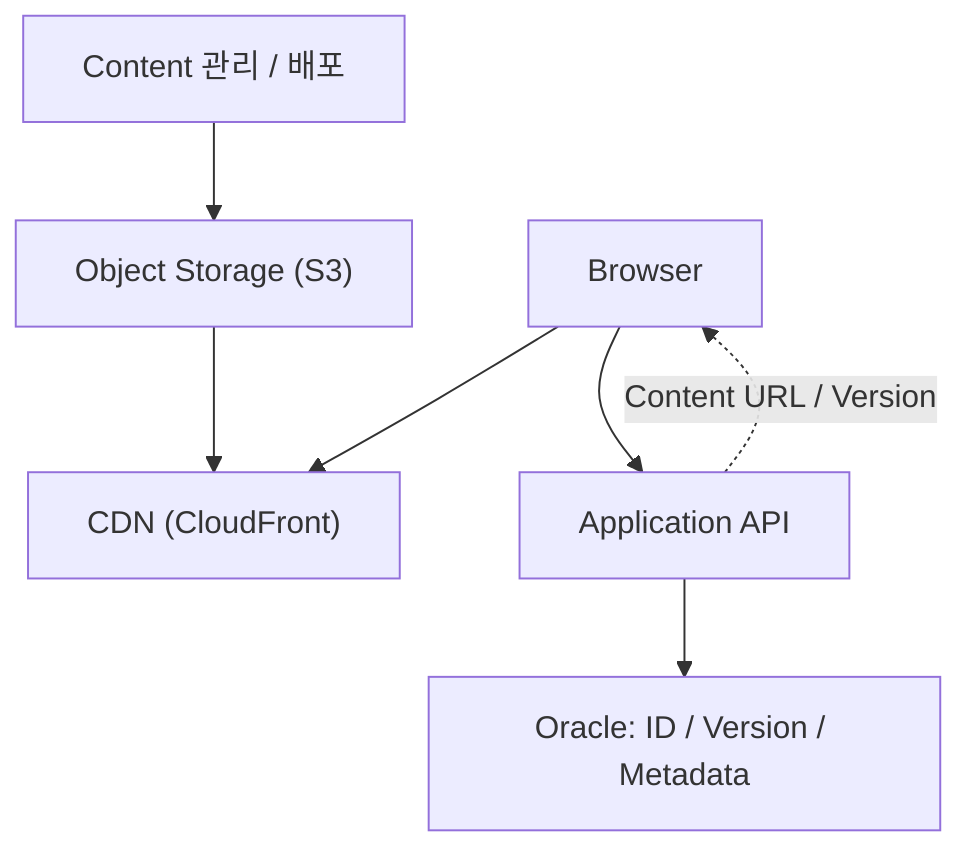

이 구조에서는 Application API가 콘텐츠 식별자와 버전, URL 등만 제공하고, 실제 본문은 CDN을 통해 전송할 수 있다. CDN Cache Hit 시 Oracle은 물론 Application API도 콘텐츠 본문 전송 경로에 참여하지 않는다.

세 방법은 콘텐츠를 제공하는 책임을 어디까지 DB에서 분리하는지가 다르다.

- `CACHE READS`: **Oracle에서 더 적은 Physical I/O로 CLOB을 읽는다.**
- Application Cache: **동일한 CLOB을 Oracle에서 읽는 빈도를 줄인다.**
- CDN 분리: **정적 본문을 전달하는 역할 자체를 Oracle에서 제거한다.**

대용량 정적 본문을 Oracle에서 반복 제공하는 구조 자체가 병목의 원인이라면, Object Storage와 CDN으로 본문 제공 경로를 옮기는 것이 DB 캐시 크기를 조정하는 것보다 근본적인 구조 개선에 가깝다. CDN이 항상 정답인 것은 아니지만, 콘텐츠가 여러 사용자에게 공통으로 제공되고 변경이 드물다는 전제에서는 효과가 크다.

물론 모든 CLOB이 CDN에 적합한 것은 아니다. 사용자별 동적 데이터, 민감한 정보, 강한 실시간 일관성이 필요한 데이터는 별도의 접근 제어와 무효화 전략이 필요하고, 경우에 따라 DB에 유지하는 편이 더 적절하다.

또한 Object Storage로 콘텐츠를 이전할 때는 원본의 소유권, 수정 시 배포 과정, URL Versioning, CDN Cache Invalidation을 함께 설계해야 한다. 예를 들어 파일명에 콘텐츠 버전을 포함하면 오래된 캐시와 새로운 콘텐츠를 구분하기 쉬워진다.

```text
/content/plan-guide/v1.html
/content/plan-guide/v2.html
```

**공통으로 제공되는 정적 본문이라면, `CACHE READS`는 기존 Oracle 조회 경로의 비용을 낮추는 방법이고 Object Storage + CDN 전환은 본문 저장·전송 책임을 DB 밖으로 옮기는 방법이다.**

---

## CACHE READS를 적용한 뒤 무엇을 측정해야 할까

애플리케이션과 콘텐츠 제공 구조를 바로 변경하기 어렵다면 STG에서 `CACHE READS`를 먼저 검증할 수 있다. 실제로는 대상 LOB 컬럼의 캐시 정책을 변경한 뒤, 동일한 부하를 재현하여 물리 읽기와 API 응답시간이 얼마나 달라지는지 확인하는 순서가 적절하다.

단, 설정 적용을 성능 개선 완료와 동일하게 취급해서는 안 된다. 확인해야 할 항목은 다음과 같다.

- 동일한 LOB를 반복 조회할 때 Physical Read 증가량이 감소하는가?
- Storage IOPS와 Read Latency가 실제로 감소하는가?
- 혼합 워크로드에서 다른 SQL의 Buffer Cache 적중률이나 응답시간이 악화되지 않는가?
- API p95/p99 Latency도 개선되는가?
- Cache Warm-up 전후와 콘텐츠 종류가 달라질 때 효과가 유지되는가?

LOB Segment는 `DBA_LOBS.SEGMENT_NAME`으로 확인할 수 있고, 권한이 있다면 `V$SEGMENT_STATISTICS`에서 관련 통계를 살펴볼 수 있다.

```sql
SELECT
    OWNER,
    OBJECT_NAME,
    STATISTIC_NAME,
    VALUE
FROM V$SEGMENT_STATISTICS
WHERE OBJECT_NAME = :lobSegmentName
  AND STATISTIC_NAME IN (
      'physical reads',
      'physical read requests',
      'logical reads'
  );
```

이 값들은 누적 통계이므로 동일한 부하 시간 구간에서 증가량을 비교해야 한다. `DBA_LOBS`와 `V$` 조회는 권한이 필요할 수 있으며, 통계 항목의 제공 여부도 확인해야 한다.

설정 변경 후에도 Physical Read가 계속 높다면 무조건 Buffer Cache를 키우기보다, 테스트 시간 동안 반복 접근하는 LOB 데이터의 총량(Working Set)과 호출 패턴을 살펴봐야 한다. 소수의 콘텐츠가 계속 요청되는지, 많은 콘텐츠를 한 번씩 읽는지에 따라 Cache Hit 가능성이 크게 달라지기 때문이다.

---

## 정리

CLOB 조회로 인해 I/O가 증가하는 현상을 보면 먼저 Storage IOPS 증설이나 DB 인스턴스 변경을 떠올리기 쉽다.

하지만 CLOB이 저장된 위치, LOB 캐시 정책, SQL에서 선택한 컬럼, JDBC 데이터 전송 방식, 애플리케이션의 반복 호출 여부를 나누어 보면 개선해야 할 비용이 각각 다르다는 것을 알 수 있다.

```text
동일 LOB의 물리적 읽기가 반복된다 → LOB CACHE READS 적용 검토
목록에서 사용하지 않는 본문을 읽는다 → 목록/상세 SQL 분리
JDBC에서 추가 LOB Read가 발생한다 → LOB Prefetch 설정 검토
동일 콘텐츠를 매번 DB에서 조회한다 → Application Cache 도입
실제 I/O 처리 한도에 도달했다 → Instance / Storage 성능 조정
정적 본문 전송에 Oracle이 계속 참여한다 → Object Storage + CDN 분리
```

`CACHE READS`는 SQL이나 애플리케이션 코드를 변경하지 않고도 반복적인 LOB Physical Read를 줄일 가능성이 있다는 점에서 단기 검증 가치가 있다. 다만 이를 적용해도 애플리케이션은 요청마다 Oracle에 접속해 CLOB 데이터를 가져오는 구조를 유지한다.

반복적으로 제공되는 정적 콘텐츠라면 관점을 한 단계 바꿀 수 있다. 그 데이터를 정말 Oracle에서 매번 제공해야 하는가?

> **가장 효과적인 I/O 최적화는 더 빠르게 읽는 것이 아니라, 읽지 않아도 되는 경로를 없애는 것이다.**

대용량 정적 본문을 다수의 사용자에게 동일하게 제공하는 환경이라면, Object Storage와 CDN으로의 전환은 Oracle의 읽기 성능을 보완하는 작업을 넘어 **콘텐츠 저장과 전송을 관계형 DB의 책임에서 분리하는 아키텍처 변경**이 된다.
